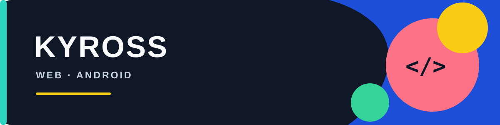

  

# Kyross 👋

Ngulik web & Android.

### 🛠️ Teknologi

  
  
  
  
  

---

### 📌 Proyek

- ♻️ [Waste](https://github.com/Luminn954/waste) — web JavaScript
- 📅 [Jadwal Sekolah](https://github.com/Luminn954/jadwal-sekolah) — TypeScript
- 🌱 [Smart Waste Android](https://github.com/Luminn954/Smart-Waste-Android) — aplikasi Android Kotlin
- ☕ [Nongkrong](https://github.com/Luminn954/nongkrong) — TypeScript
